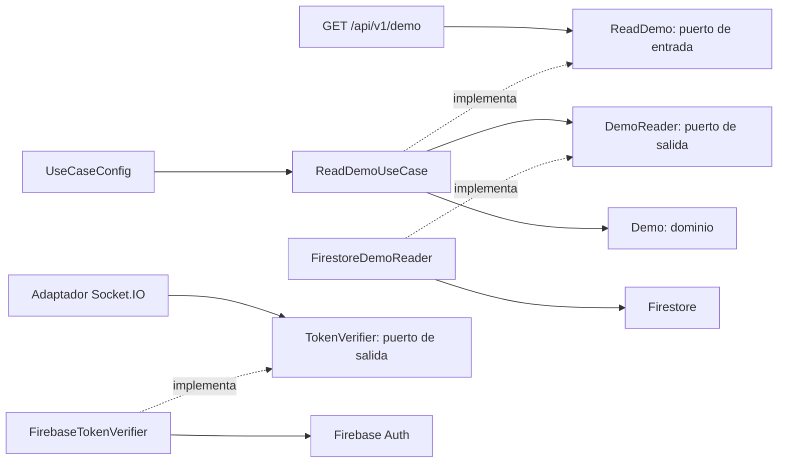
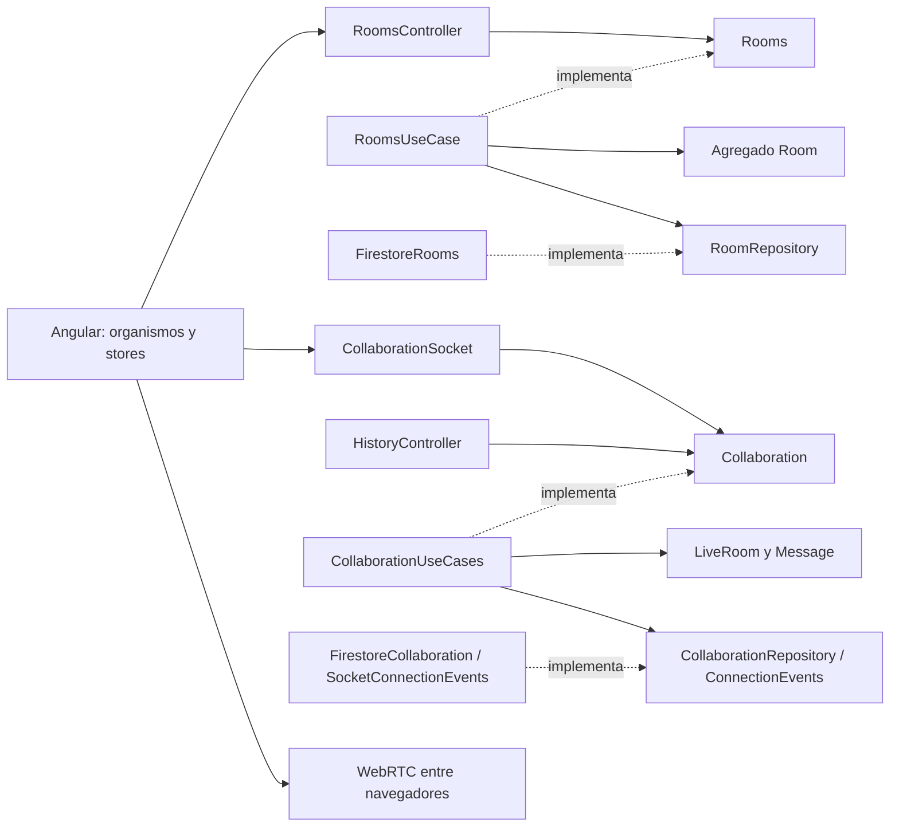

# Arquitectura hexagonal

Maven agrega dos aplicaciones independientes; no hay dependencia entre módulos ni librería compartida de dominio. Cada servicio contiene `domain`, `application` e `infrastructure`. Las carpetas reservadas todavía vacías conservan `.gitkeep`.

El controlador depende del puerto, no del caso de uso. `UseCaseConfig` conecta sus implementaciones. Dominio y aplicación son Java puro. Los modelos Firebase, CDI, REST y Socket.IO permanecen en infraestructura. Realtime implementa CollaborationUseCases sobre puertos de persistencia y entrega; consultar [los agregados y sus límites](salas-chat.md).

REST ejecuta lecturas bloqueantes en workers (`@Blocking`); readiness usa un check asíncrono que deriva la consulta a workers. Los callbacks de paquetes Socket.IO, incluido Firebase Auth, se desplazan a un grupo de cuatro ejecutores ordenados por canal; el event loop de Netty sigue atendiendo transporte. El grupo y el listener se cierran al apagar Quarkus.

El guard de paquetes rechaza CONNECT sin datos antes del handler de netty-socketio, que omite su AuthTokenListener para ese formato. Solo se admite Engine.IO 4 y el namespace raíz tiene el verificador. No hay namespaces de negocio. El callback ConnectListener de esta biblioteca sucede antes de la autenticación de namespace: no se usa como prueba de identidad.

ArchUnit verifica clases reales: entrada sin dependencia directa de casos de uso/adaptadores de salida y núcleo sin dependencias de infraestructura/frameworks. Las entidades futuras de persistencia deben permanecer separadas del dominio.

## Identidad Sprint 1

`ReadSession`, `CompleteProfile`, `GetMyProfile` y `Logout` son puertos de entrada implementados por casos de uso puros. `ProfileRepository` y `SessionGateway` son puertos de salida. La transacción Firestore y Firebase Auth permanecen en infraestructura; el dominio define perfiles, normalización y política de correo.

Quarkus Security extrae Bearer y ejecuta la validación Firebase en workers mediante un IdentityProvider. Las rutas privadas requieren rol derivado de estado COMPLETE en servidor; las excepciones para bootstrap/finalización/logout solo exigen sesión. El controlador nunca acepta uid o email del formulario. La lectura de sesión no escribe documentos; la finalización crea perfil y reserva atómicamente.

## Colaboración: contextos separados

API contiene Room, RoomsUseCase y RoomRepository. Realtime contiene Message, Participant y LiveRoom, con CollaborationUseCases, CollaborationRepository y ConnectionEvents. El adaptador entrante llama únicamente a puertos; CDI conecta los adaptadores salientes. No hay dependencias Maven entre módulos. Firestore compartido tiene propiedad de escritura documentada y una excepción de limpieza controlada por API.

La arquitectura se prueba sobre clases reales con ArchUnit. Presencia/capacidad requieren una sola réplica realtime. No se comparte dominio entre microservicios ni se transportan vídeos por el backend.
