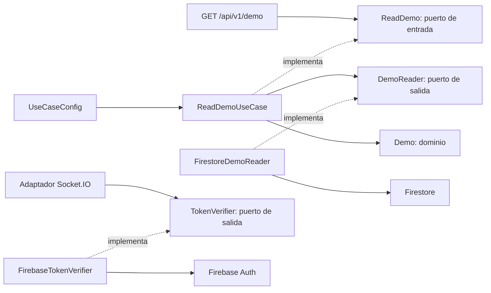

# Arquitectura hexagonal

Maven agrega dos aplicaciones independientes; no hay dependencia entre módulos ni librería compartida de dominio. Cada servicio contiene `domain`, `application` e `infrastructure`. Las carpetas reservadas todavía vacías conservan `.gitkeep`.

El controlador depende del puerto, no del caso de uso. `UseCaseConfig` conecta sus implementaciones. Dominio y aplicación son Java puro. Los modelos Firebase, CDI, REST y Socket.IO permanecen en infraestructura. La prueba realtime es un adaptador técnico, todavía sin casos de uso de salas/chat.

REST ejecuta lecturas bloqueantes en workers (`@Blocking`); readiness usa un check asíncrono que deriva la consulta a workers. Los callbacks de paquetes Socket.IO, incluido Firebase Auth, se desplazan a un grupo de cuatro ejecutores ordenados por canal; el event loop de Netty sigue atendiendo transporte. El grupo y el listener se cierran al apagar Quarkus.

El guard de paquetes rechaza CONNECT sin datos antes del handler de netty-socketio, que omite su AuthTokenListener para ese formato. Solo se admite Engine.IO 4 y el namespace raíz tiene el verificador. No hay namespaces de negocio. El callback ConnectListener de esta biblioteca sucede antes de la autenticación de namespace: no se usa como prueba de identidad.

ArchUnit verifica clases reales: entrada sin dependencia directa de casos de uso/adaptadores de salida y núcleo sin dependencias de infraestructura/frameworks. Las entidades futuras de persistencia deben permanecer separadas del dominio.
